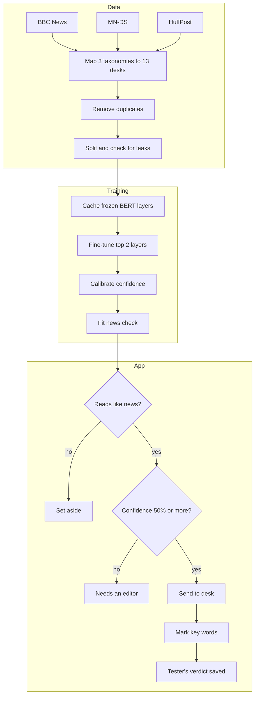

# NewsLens

Paste a news story and NewsLens sorts it to one of 13 newsroom desks, shows how sure it is, and marks the words that swayed it most. If it can't tell, it says so. If the text isn't news at all, it sets it aside instead of forcing it onto a desk. Testers can mark each answer right or wrong, and those answers are saved for review.

It started as a course lab on BERT transfer learning with the five BBC News topics. This version extends that lab into something people can use: more data, more topics, a trained model behind a real interface, and honest handling of the cases where a classifier should stay quiet.

## Results

Measured on the saved model, on stories held out from all training and tuning.

| Measure | Result |
|---|---|
| Accuracy, full stories (1,745) | **82.9%** |
| Macro-F1, 13 desks | **0.83** |
| Accuracy, headline alone (874) | 65.6% |
| Accuracy when it commits to a desk | 85.7%, on 91.5% of stories |
| Confidence vs reality, full stories | within 2.6 points |
| Confidence vs reality, headlines | 12.7 points too sure |
| Real stories wrongly set aside as not news | 2.5% |

The strongest desks are Conflict & War and Sport (F1 0.93). The weakest is Science & Technology (0.69), which it most often confuses with Business, Health and Environment. [docs/findings.md](docs/findings.md) has the full results and what they mean.

## How it works



[docs/architecture.md](docs/architecture.md) explains each step and why it was built that way. [docs/data.md](docs/data.md) covers the datasets, the label mapping and the cleaning.

## Run it

Python 3.13 was used for everything here.

```bash
python -m venv .venv && source .venv/bin/activate
pip install -r requirements.txt
python app.py
```

Then open http://localhost:7860. This needs the trained model in `artifacts/model/`.

## Rebuild it from scratch

```bash
pip install -r requirements-train.txt
python scripts/train.py              # about 70 minutes on 2 CPU cores
python scripts/fit_news_gate.py      # about 15 minutes
python scripts/evaluate.py           # re-scores the saved model
python scripts/check_examples.py     # sample stories and non-news text
pytest
```

Add `--limit 600 --epochs 1` to `train.py` for a quick end-to-end run. That model is useless but proves the pipeline works.

## Project layout

```text
app.py                  Gradio interface and the Hugging Face Spaces entry point
src/newslens/
  taxonomy.py           The 13 desks and how each dataset's labels map to them
  data.py               Load, clean, de-duplicate, split, check for leaks
  modeling.py           Freezing and the cached forward pass
  predictor.py          Topic, confidence, news check, word explanations
  render.py             HTML for the slip and marked-up story
  feedback.py           Saves testers' verdicts
  examples.py           Hand-written sample stories
  theme.py              Look and feel
scripts/                Train, fit the news check, evaluate
tests/                  19 tests covering model, data and interface logic
artifacts/model/        Trained model, calibration and news check
artifacts/results/      metrics.json and examples.json
docs/                   Architecture, data and findings
```

## Deploy to Hugging Face Spaces

This repo is set up as a Gradio Space, but it hasn't been deployed yet.

1. Create a Gradio Space on the free CPU tier.
2. Run `git lfs install` and `git lfs track "*.safetensors"`, because the model is 210 MB.
3. Push this folder to the Space.

Feedback saved on a free Space disappears when it restarts. Keep the verdicts by mounting persistent storage or sending them to a Hugging Face dataset.

## Limits

- **Topic only.** It doesn't check whether a story is true.
- **English only**, and it reads about the first 100 words.
- **One desk per story.** Plenty of real stories belong on two.
- **Dated training data.** Stories run from 2004 to 2022, so recent names and events can throw it off.
- **Headlines are weak.** It's right about two times in three, and overconfident. The app warns on short text.
- **Uneven labels.** Conflict and Disasters come from a single source, MN-DS, so their high scores may not carry over to other publishers.
- **The news check has gaps.** It catches the kinds of text it was trained on far better than kinds it hasn't seen, and it wrongly sets aside about 9% of health stories.

## Data and credits

| Dataset | Rows used | Licence as stated on the Hub |
|---|---:|---|
| [SetFit/bbc-news](https://huggingface.co/datasets/SetFit/bbc-news) | 2,102 | Not stated; check before commercial use |
| [textminr/mn-ds](https://huggingface.co/datasets/textminr/mn-ds) | 8,752 | "cc" (no specific version) |
| [heegyu/news-category-dataset](https://huggingface.co/datasets/heegyu/news-category-dataset) | 6,595 | CC BY 4.0 |

Non-news examples for the news check come from [ucirvine/sms_spam](https://huggingface.co/datasets/ucirvine/sms_spam), [Abirate/english_quotes](https://huggingface.co/datasets/Abirate/english_quotes), [stanfordnlp/imdb](https://huggingface.co/datasets/stanfordnlp/imdb), [dair-ai/emotion](https://huggingface.co/datasets/dair-ai/emotion) and [SetFit/enron_spam](https://huggingface.co/datasets/SetFit/enron_spam), plus installed Python source code and generated gibberish.

The base model is [google-bert/bert-base-uncased](https://huggingface.co/google-bert/bert-base-uncased). No licence has been chosen for this code yet. The trained model inherits the terms of its source data, so check those before any commercial use.
